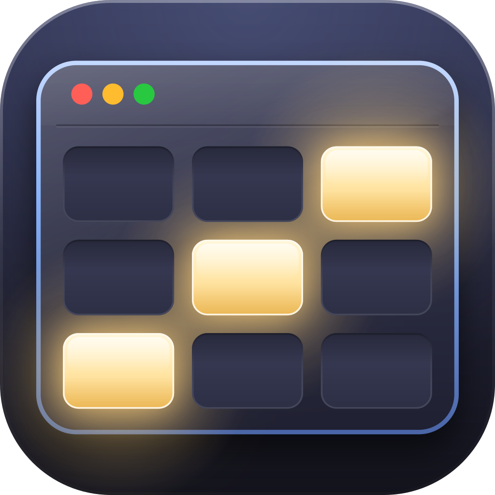
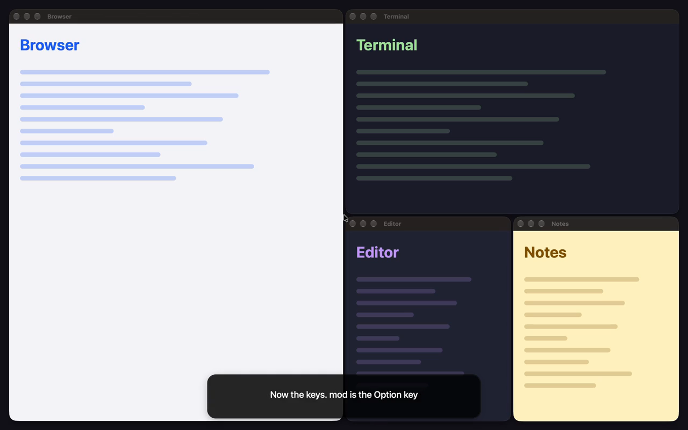

<p align="center">
  
</p>

# wm

## Demo

[](docs/assets/wm-walkthrough.mp4)

A 56-second walkthrough, from the first run to the keys that you use each day. You pick a starter config and press Start,
and wm tiles the windows. Then the keys focus, swap, split, float and fullscreen windows, and move them between
workspaces. Each key shows on screen when it is pressed. The windows are demo windows.

## Overview

wm is a tiling window manager for macOS. It is written in Swift, runs with SIP on, and you configure it in Lua.

It has three layouts. **Scrolling** puts windows in columns on a strip that moves sideways, as niri and PaperWM do.
**Tiling** splits the screen in a tree, as Hyprland's dwindle layout does. **Master-stack** keeps one big area and a
stack, as dwm does. You choose the layout per workspace and change it while wm runs.

- Site: <https://wm.garcez.dev>
- Documentation: <https://wm.garcez.dev/docs/getting-started>
- Repository: <https://github.com/g4rcez/wm>
- License: [MIT](LICENSE)

wm has no default key bindings. Until you bind keys in `init.lua`, it only reacts to the `wm` command and to the
[built-in trackpad swipes](https://wm.garcez.dev/docs/config).

## Table of contents

- [Demo](#demo)
- [Overview](#overview)
- [Features](#features)
  - [Layouts](#layouts)
  - [Workspaces and monitors](#workspaces-and-monitors)
  - [Keys, modes and the key panel](#keys-modes-and-the-key-panel)
  - [Gestures and mouse](#gestures-and-mouse)
  - [Rules and window memory](#rules-and-window-memory)
  - [Finding and switching windows](#finding-and-switching-windows)
  - [Keyboard clicking, scrolling and text selection](#keyboard-clicking-scrolling-and-text-selection)
  - [Window tools](#window-tools)
  - [Scripting and automation](#scripting-and-automation)
  - [Reliability](#reliability)
  - [Editor and shell support](#editor-and-shell-support)
- [Install](#install)
- [Your first config](#your-first-config)
- [Documentation](#documentation)
- [Command line cheat sheet](#command-line-cheat-sheet)
- [Limits](#limits)
- [Development](#development)
- [Credits](#credits)
- [License](#license)

## Features

### Layouts

| Feature | What it does |
|---|---|
| Scrolling | Columns on a strip. A new window opens beside the focused one and never resizes the others. A column holds a stack or tabs. A second, vertical strip can sit at one side. The strip can also run vertically. |
| Tiling | A binary tree. A new window splits the focused one. It has preselect, split ratio, flip, pseudo-tiling, and smart split under the pointer. |
| Master-stack | A master area and a stack, with `left`, `right`, `top`, `bottom` and `center` orientations. |
| Monocle | One window fills the workspace. `focus next` and `focus prev` walk through the others, which wait out of sight. |
| Tile templates | Ready-made arrangements (`2`, `3`, `2+1`, `2/3`, `center`, and more) with a picker. You can write your own. |
| Rotate, maximize, floating | Rotate a layout, maximize, floating windows, snap to a part of the screen, native fullscreen and window marks. |
| Undo and redo | `layout undo` takes back a swap, a resize, a tile pattern or a drag. `layout redo` does it again. |

### Workspaces and monitors

- **Emulated workspaces** (like AeroSpace). wm hides the windows of other workspaces, so it needs no macOS desktops. You can
  have any number of workspaces with any name.
- **Native workspaces** (opt in with `workspaces = "native"`, like Dinky). Each workspace is a macOS desktop and SIP stays on. See
  [Native workspaces](https://wm.garcez.dev/docs/config#native-workspaces).
- **Several monitors.** A workspace shows on one monitor at a time. Name a monitor by role (`main`, `secondary`), by number or
  by part of its name.
- **Per-workspace settings:** layout, gaps, border and monitor. See [Configuration](https://wm.garcez.dev/docs/config).
- **Special workspaces** (scratchpads, like Hyprland). One key shows one over the others and the same key hides it.
  See [Layouts](https://wm.garcez.dev/docs/layouts).
- Gaps, animated moves and resizes, and a focus border. See the [Configuration](https://wm.garcez.dev/docs/config).

### Keys, modes and the key panel

- **Chords and sequences:** `alt-h`, `cmd+ctrl-2`, and sequences such as `alt-space>h`. A sequence can stay active for
  several commands (`wm.commands = { mode = "persistent" }`). See [Configuration](https://wm.garcez.dev/docs/config).
- **Binding modes:** a separate set of keys, for example a resize mode. Modes can end after one key (`once`) and go back to the
  mode before them (`mode back`).
- **Key panel** (like which-key.nvim). It lists the keys that you can press in a mode or after a prefix.
  See [Configuration](https://wm.garcez.dev/docs/config).
- **Bind options:** `description`, `repeating`, `release`, `long_press` and `universal`.
- **Shortcuts window:** the menu bar item **Shortcuts…** adds, edits and deletes binds (type the keys or record them), and
  saves them in `shortcuts.toml`.
  `init.lua` loads the file with `wm.shortcuts()`, so you can use the window, Lua, or both. `wm doctor` reports errors in
  the file and binds that `init.lua` replaces. See [Configuration](https://wm.garcez.dev/docs/config).
- **Hyper key and remaps:** CapsLock becomes `hyper` (Esc when tapped alone), `wm.remap` types other keys, and `wm.press`
  sends keys and media keys. wm can also [replace a Karabiner-Elements setup](https://wm.garcez.dev/docs/config) built
  around a hyper key.
- **Per-keyboard settings:** turn the CapsLock mapping on or off for each keyboard (`wm query keyboards`).

### Gestures and mouse

- **Trackpad swipes with 3 or 4 fingers** work with no config: workspaces, overview, and scrolling the strip. Swipes with
  modifier keys (`wm.gesture`) are also available. Two-finger swipes and pinches on a window's title bar (snap, move,
  maximize, minimize, close, as in Swish) are opt-in with `trackpad = { title_bar = true }`. See
  [Configuration](https://wm.garcez.dev/docs/config).
- **Mouse:** drag the edges of tiles to resize, drag a tile to swap, and hold a modifier to move or resize any window. See
  [Features](https://wm.garcez.dev/docs/features).

### Rules and window memory

- **Window rules** match new windows by app or title and decide the workspace, monitor, size, floating and focus. wm also ships
  [default floating rules](https://wm.garcez.dev/docs/config) for browser popups, Finder, System Settings and similar windows.
- **Window memory:** `window remember` gives the next window of an app the same workspace, monitor, size and place.
  Floating windows also remember where they closed. `wm memory list`, `forget` and `clear` manage the entries from the command line.
  See [Features](https://wm.garcez.dev/docs/features).
- **Sessions:** `session save dev` keeps your windows and layouts under a name. `session open dev` puts them back and starts the
  apps that are missing. See [Features](https://wm.garcez.dev/docs/features#sessions).

### Finding and switching windows

- **Switcher and overview:** an Alt+Tab switcher with a picture of each window, and an overview that shows every workspace as a
  small copy of its screen. You can drag a card to another workspace. See [Features](https://wm.garcez.dev/docs/features).
- **Command palette:** one panel for windows, apps, browser tabs, tmux windows, wm commands (`>`) and menu items (`/`). It also
  works as a Cmd+Tab switcher. See [Features](https://wm.garcez.dev/docs/features).
- **Cheatsheet:** `wm cheatsheet [tui|gui]` lists the keys of your config in sections, with a filter, in the terminal or in a panel. `wm cheatsheet cli` prints the same keys as plain text, one per line, to use with `grep`, `less`, `more` or `cat`.
  See [Features](https://wm.garcez.dev/docs/features).
- **Appearance:** the overlays (palette, cheatsheet, switcher, overview, template picker, key label) look like macOS by default and follow
  light and dark. One `wm.config { appearance = { ... } }` sets the style, theme, density, blur, accent, colors, corners and fonts of all of them.
  See [Configuration](https://wm.garcez.dev/docs/config).
- **Run or raise:** one key focuses an app, or starts it when it has no window. See [Features](https://wm.garcez.dev/docs/features).
- **Menu Anywhere:** the menus of the focused app as a pop-up at the mouse pointer. See [Features](https://wm.garcez.dev/docs/features).

### Keyboard clicking, scrolling and text selection

- **Hints:** two-letter labels on every clickable element of the screen (or only of the focused window), the menu bar and the Dock, with fuzzy search. Works as
  Homerow does.
- **Scroll mode:** number the scroll areas and scroll them with `h` `j` `k` `l`.
- **Jump:** a giant number on every visible window; type it to focus the window (`--swap` and `--close` do other things).
  See [Features](https://wm.garcez.dev/docs/features).
- **Select mode:** search the text on the screen, select it with vim keys or labels, then copy it (`y`, `Cmd-C` or `Return`) or
  right-click it. Every key of the select step can change with `wm.config { select = { keys = { ... } } }`.

See [Features](https://wm.garcez.dev/docs/features).

### Window tools

- **Sticky windows:** a floating window that shows on every workspace of its monitor.
- **Zen mode:** show only the focused window, centered.
- **Window swallowing:** a program that you start in a terminal takes the place of the terminal window, and the terminal comes back when it closes.

See [Layouts](https://wm.garcez.dev/docs/layouts) and [Features](https://wm.garcez.dev/docs/features).

### Scripting and automation

- **One command set with three entry points:** the `wm` CLI, Lua (`wm.dispatch`) and `wm://` URLs.
  See [Command line](https://wm.garcez.dev/docs/cli) (it also covers `wm://` URLs) and
  [Lua API](https://wm.garcez.dev/docs/lua-api).
- **Events:** `wm.on("window_open", ...)` in Lua, or `wm subscribe` for JSON lines in a shell script or a status bar.
- **Queries:** `wm list windows --json`, `wm query`, `wm pick`, and `--window app:<name>` selectors.
- **Batches and temporary changes:** `wm batch`, `wm set`, `wm exec` with window options, and `wm notify`.

### Reliability

- **Saved state:** layouts survive a restart of the daemon and a reboot. See [Features](https://wm.garcez.dev/docs/features).
- **Safe reload:** wm reloads `init.lua` when you save it. If the file has an error, the old config stays active and the error
  shows in a notification, in the menu bar and in `wm logs`.
- **Logs:** `wm logs` reads a JSON log that works when the daemon is stopped.

### Editor and shell support

- **Lua autocomplete:** `wm lsp --write` sets up [lua-language-server](https://luals.github.io/) for `init.lua`, with
  completion, hover help and warnings for the whole API. See [Lua API](https://wm.garcez.dev/docs/lua-api). It also sets up
  [Taplo](https://taplo.tamasfe.dev/) for `shortcuts.toml`.
- **Shell completion** for zsh and bash: `eval "$(wm completion zsh)"`.
- **AI agents:** `wm skills` prints a skill that teaches an agent to use wm. See [Command line](https://wm.garcez.dev/docs/cli).

## Install

Requirements:

- macOS 14 or later.
- The Swift 6.2 toolchain (Xcode or the command line tools).
- No other window manager running (AeroSpace, yabai, Amethyst). Two of them fight over the same windows.

With Homebrew, the formula in [g4rcez/homebrew-tap](https://github.com/g4rcez/homebrew-tap) installs the signed app of the latest release:

```sh
brew install g4rcez/tap/wm
wm daemon start
# later: brew upgrade g4rcez/tap/wm && wm daemon reload   (the permissions stay; reload restarts wm from the new build)
```

Or build it yourself:

```sh
git clone https://github.com/g4rcez/wm.git
cd wm
./build-app.sh      # builds .build/wm.app (daemon and CLI), signs it, and starts it
```

Other tasks:

```sh
make                                       # lists the tasks
make test                                  # unit tests
make install CODESIGN_IDENTITY="<name>"    # build, sign, copy to /Applications/wm.app, link wm in ~/.local/bin, start it
```

macOS asks for **Accessibility** at the first start: wm cannot move windows without it. **Screen Recording** (window
pictures) and **Automation** (browser tabs in the palette) are optional. The menu bar icon needs System Settings > Menu Bar >
"Allow in the Menu Bar" > `wm`.

Releases are signed with one certificate, so the Homebrew install keeps the permissions through upgrades. When you build it
yourself, sign with a stable certificate: an ad-hoc signature changes with every build, and macOS asks for the permissions again. The [Getting started](https://wm.garcez.dev/docs/getting-started) page explains permissions, signing, the `PATH` link, shell
completion and start at login (`start_at_login = true`).

```sh
wm daemon start    # starts wm.app in the background
wm daemon status   # whether it runs, the workspace, the mode, the window count
wm daemon stop     # quits wm; hidden windows come back on screen
```

## Your first config

Create `~/.config/wm/init.lua` (or `$XDG_CONFIG_HOME/wm/init.lua`, or the file named by `$WM_CONFIG`):

```lua
wm.config {
  layout = "tiling",
  gaps = { inner = 8, outer = 8 },
  border = { enabled = true, width = 2, active = "#89b4fa" },
}

-- Focus and move with vim keys
wm.bind("alt-h", "focus left --wrap")
wm.bind("alt-j", "focus down --wrap")
wm.bind("alt-k", "focus up --wrap")
wm.bind("alt-l", "focus right --wrap")
wm.bind("alt-shift-h", "swap left")
wm.bind("alt-shift-l", "swap right")

-- alt-N shows workspace N, alt-shift-N sends the window there
for n = 1, 9 do
  wm.bind("alt-" .. n, "workspace " .. n)
  wm.bind("alt-shift-" .. n, "window send workspace " .. n)
end

wm.bind("alt-f", "window fullscreen")
wm.bind("alt-space", "window float")
wm.bind("alt-s", "layout set scrolling")
wm.bind("alt-t", "layout set tiling")
wm.bind("alt-shift-c", "daemon reload")
```

Save the file and wm reloads it. Run `wm help` to see every command. More recipes (modes, prefix keys, rules, events) are
on the [Configuration](https://wm.garcez.dev/docs/config) page. A full configuration in use is in the author's
[dotfiles](https://github.com/g4rcez/dotfiles/blob/master/config/wm/init.lua).

## Documentation

Everything is on <https://wm.garcez.dev/docs/getting-started>. The source of the pages is in [`docs/src/content/docs`](docs/src/content/docs).

- [Getting started](https://wm.garcez.dev/docs/getting-started): what wm is, install, the first five minutes.
- [Configuration](https://wm.garcez.dev/docs/config): config files, key binds, rules, gestures, appearance, examples.
- [Layouts](https://wm.garcez.dev/docs/layouts): scrolling, tiling, master, monocle, floating, templates, special workspaces.
- [Features](https://wm.garcez.dev/docs/features): switcher, palette, hints, jump, window memory, menu bar and more.
- [Command line](https://wm.garcez.dev/docs/cli), [Lua API](https://wm.garcez.dev/docs/lua-api), [Troubleshooting](https://wm.garcez.dev/docs/troubleshooting), [Development](https://wm.garcez.dev/docs/development).

## Command line cheat sheet

The same words work in `wm.bind`, in Lua (`wm.dispatch`) and in `wm://` URLs. `wm help <command>` shows one command.

```sh
wm focus left --wrap                     # focus, move, swap, resize
wm focus urgent                          # the app whose Dock badge appeared or grew; also urgent-or-last
wm workspace 2                           # show a workspace; also next, prev, back, empty, special <name>
wm window send workspace 3               # move the focused window
wm layout set scrolling                  # scrolling | tiling | master | monocle | floating
wm switcher                              # also: overview, palette, menu, zen
wm list windows --json                   # windows, workspaces, monitors, keyboards, memory, binds
wm memory forget com.apple.Notes        # list | forget <app> | clear: what `window remember` kept
wm --window app:com.apple.Notes window close
wm batch 'workspace 2; layout set tiling'
wm subscribe --snapshot window_focus     # one JSON event per line
wm logs -f                               # follow the log
wm daemon reload                         # also: start, stop, status, version
```

Errors go to stderr. Exit code 2 means a wrong use of the command, and 1 means it could not run.

## Limits

- Animations move real windows through the Accessibility API, one call per frame. Slow apps (Electron) can stutter.
- wm cannot blur, fade or shadow the windows of other apps.
- Gestures with fingers use the private MultitouchSupport framework, and a macOS update can change it.
- A window with a minimum size larger than its tile overlaps its neighbours.

See [Troubleshooting](https://wm.garcez.dev/docs/troubleshooting) for fixes and the full list.

## Development

```sh
timeout 300 swift test      # unit tests: layout engines, geometry, Lua host, IPC, command parsing
./build-app.sh debug        # a debug build of the app bundle
```

| Target | Role |
|---|---|
| `CLua` | Vendored Lua 5.4.9 |
| `Common` | IPC (length-prefixed JSON over a unix socket), command table, help, URL parsing and shell completion |
| `Core` | Pure layout engines, animator, gaps, navigation, the geometry of the overview. No AppKit. |
| `Scripting` | Lua host, chords, binds, gestures, config validation |
| `Platform` | Accessibility threads, displays, event tap, overlays, SkyLight reader |
| `PrivateApi` | C bindings to private macOS functions |
| `App` | `wmd`: window manager state, commands, config, menu bar, URL handler |
| `Cli` | `wm` |

The documentation site is an [Astro](https://astro.build) project in [`docs`](docs): `cd docs && pnpm install && pnpm dev`.
The app icon is `assets/icon-windows.svg`, and `assets/make-icns.sh` makes `bundle/wm.icns` from it. See the
[Development](https://wm.garcez.dev/docs/development).

## Credits

wm borrows ideas from projects it does not copy code from:

- [Hyprland](https://hypr.land/): the dwindle layout, special workspaces and submaps (modes).
- [which-key.nvim](https://github.com/folke/which-key.nvim) for Neovim: the idea of a panel that lists the next keys.
- [niri](https://github.com/niri-wm/niri) and PaperWM: the scrolling strip of columns.
- [AeroSpace](https://github.com/nikitabobko/AeroSpace): emulated workspaces on macOS without disabling SIP.
- [Ribbon](https://meetribbon.app/): the pictures of the tile templates. The patterns are an original implementation and
  use none of its code.

The scrolling semantics are ported from [paneru](https://github.com/karinushka/paneru) (MIT). Lua is vendored under the
MIT license. [`legal/THIRD_PARTY.md`](legal/THIRD_PARTY.md) has the full notices.

## License

wm is released under the MIT License. See [LICENSE](LICENSE).
